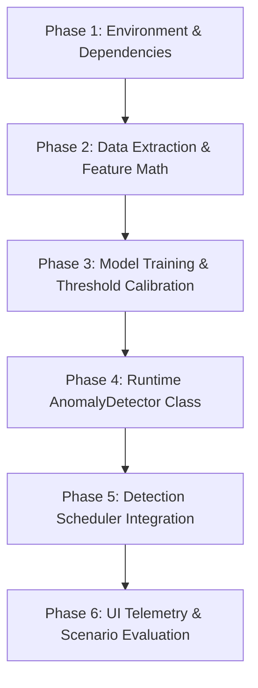

# Solo Developer ML Track Master Execution Plan (Single-Day Rapid Delivery)

**Developer:** Rushikesh (Solo Execution)  
**Target Delivery Date:** 26 October 2026 (Completed Today)  
**Scope:** Full ML Pipeline (Data Baseline $\to$ Feature Extraction $\to$ Training & Calibration $\to$ Inference Engine $\to$ Scheduler Integration $\to$ Evaluation & UI)  
**Strategy:** Lean, linear, sequential pipeline without multi-developer merge bottlenecks. Heavy offline dependencies (`pandas`) isolated from the runtime backend.

---

## 1. Executive Summary & Architecture Overview

The purpose of this plan is to deliver the complete S4 (Isolation Forest anomaly detection) and S5 (evaluation) requirements within a single working session by removing team synchronization overhead and executing a streamlined 6-stage linear pipeline.



### Core Architecture Rules:
1. **Unification:** Single feature definition in `backend/app/ml/features.py` serves both offline training and online real-time inference.
2. **ML as Primary Alert:** Incidents are triggered when the composite **Isolation Forest Anomaly Score** breaches the calibrated decision threshold for $N=3$ consecutive 15s evaluation cycles.
3. **Resilience / Fallback:** If `isolation_forest.pkl` is absent or unreadable, the scheduler logs a clean warning and falls back to static threshold checking with zero downtime.
4. **Lightweight Runtime:** Backend container pins `scikit-learn`, `numpy`, and `joblib`. No `pandas` or plotting libraries inside production containers.

---

## 2. Telemetry Features Specification

Every 15-second cycle over a **5-minute rolling lookback window** ($W = 5\text{m}$, requiring at least 12 valid points):

| # | Feature Name | Formula / Query | Data Source |
|---|---|---|---|
| **1** | `cpu_pct_mean_5m` | Rolling mean of `demo-app` CPU % | Prometheus (`process_cpu_seconds_total`) |
| **2** | `cpu_pct_std_5m` | Standard deviation of `demo-app` CPU % | Prometheus (`process_cpu_seconds_total`) |
| **3** | `latency_p95_mean_5m` | Rolling mean of P95 latency (seconds) | Prometheus (`http_request_duration_seconds`) |
| **4** | `latency_p95_std_5m` | Standard deviation of P95 latency | Prometheus (`http_request_duration_seconds`) |
| **5** | `error_rate_5m` | Percentage of 5xx HTTP responses | Prometheus (`http_requests_total`) |
| **6** | `request_rate_mean_5m`| Average requests/sec over 5m | Prometheus (`http_requests_total`) |
| **7** | `container_die_count_15m`| Total `container.die` + `container.oom` (15m window) | PostgreSQL (`events` table) |
| **8** | `data_dir_growth_5m` | Delta in bytes of `demo_data_dir_bytes` over 5m | Prometheus (`demo_data_dir_bytes`) |

---

## 3. Solo Execution Pipeline (Step-by-Step)

### Phase 1: Environment Setup & Volume Configuration (Estimated: 25 mins)
* **Goal:** Configure local and container dependencies and ensure filesystem mounts.
* **Tasks:**
  1. Add runtime dependencies to `backend/requirements.txt`:
     ```text
     numpy>=1.24.0
     scikit-learn>=1.3.0
     joblib>=1.3.0
     ```
  2. Create local offline environment file `ml/requirements-train.txt` (includes `pandas` and `requests` for data extraction).
  3. Update `docker-compose.yml`:
     - Mount `./ml/models:/models:ro` into the `backend` service.
     - Add environment variable: `DETECTION_MODE=ml`.
  4. Create working directories:
     - `ml/data/`
     - `ml/models/`
     - `ml/traces/`
     - `ml/evaluation/`
     - `backend/app/ml/`
* **Success Criteria:** `docker compose up -d backend` rebuilds and starts healthy.

---

### Phase 2: Feature Engineering & Baseline Data Extraction (Estimated: 45 mins)
* **Goal:** Create unified feature library and export real baseline training data from the running stack.
* **Tasks:**
  1. Implement `backend/app/ml/features.py`:
     - Define Prometheus query strings for CPU, P95 latency, error rate, request rate, and data directory bytes.
     - Implement pure `numpy` functions for rolling window computations:
       * `calc_mean_std(values)`
       * `calc_rate_delta(start_val, end_val, time_delta)`
     - Add minimum point guard (returns `None` if valid data points $< 12$).
  2. Implement extraction script `ml/collect_baseline.py`:
     - Queries Prometheus range API (15s step) and PostgreSQL `events` table.
     - Combines telemetry into the 8 ordered features.
     - Drops incomplete rows and outputs a clean dataset.
  3. Extract real data:
     - Run against the active demo stack to export `ml/data/normal_train.csv` (using past 45–60 minutes of normal traffic).
     - Export a secondary slice as `ml/data/normal_validate.csv` (using past 15–20 minutes).
* **Success Criteria:** Both CSV files exist with valid values and zero `NaN` entries.

---

### Phase 3: Model Training & Threshold Calibration (Estimated: 35 mins)
* **Goal:** Train the Isolation Forest model and empirically calibrate the anomaly threshold.
* **Tasks:**
  1. Implement `ml/train.py`:
     - Load `ml/data/normal_train.csv`.
     - Compute and record feature means and standard deviations.
     - Fit `IsolationForest(n_estimators=150, max_samples='auto', contamination='auto', random_state=42)`.
     - Export binary model to `ml/models/isolation_forest.pkl`.
  2. Implement calibration in `ml/calibrate.py`:
     - Score validation data `ml/data/normal_validate.csv` using:
       $$\text{score} = -\text{score\_samples}(X)$$
     - Compute the 99.5th percentile score and calculate the decision boundary:
       $$\text{Threshold} = P_{99.5}(\text{validation\_scores}) + 0.02$$
     - Save metadata to `ml/models/feature_metadata.json` containing:
       * `model_version`: `"iforest-v1.0"`
       * `features`: list of 8 feature names in exact order
       * `threshold`: calibrated float
       * `feature_means`: mapping of feature name $\to$ mean
       * `feature_stds`: mapping of feature name $\to$ standard deviation
       * `model_sha256`: SHA-256 hash of `isolation_forest.pkl`
* **Success Criteria:** `isolation_forest.pkl` and `feature_metadata.json` exist in `ml/models/`.

---

### Phase 4: Runtime AnomalyDetector Engine (Estimated: 40 mins)
* **Goal:** Implement the resilient inference wrapper inside `backend/app/ml/`.
* **Tasks:**
  1. Implement `backend/app/ml/inference.py`:
     ```python
     class AnomalyDetector:
         def __init__(self, model_dir: str = "/models"):
             ...
         def load(self) -> bool:
             # Loads model & metadata; verifies SHA256 and feature count
             # Returns False cleanly if missing or corrupt
         def score(self, feature_vector: list[float]) -> dict:
             # Computes anomaly score: -score_samples([feature_vector])[0]
             # Determines is_anomaly: score >= threshold
             # Computes top 3 contributing features by z-score
             # Returns structured dict
     ```
  2. Implement fallback handling:
     - If loading fails, `is_loaded = False`. The detector never raises unhandled exceptions.
  3. Write isolated unit test `backend/tests/test_ml_inference.py`:
     - Test valid prediction.
     - Test missing model file (graceful fallback check).
     - Test feature vector dimension mismatch.
* **Success Criteria:** `pytest backend/tests/test_ml_inference.py` passes 100%.

---

### Phase 5: Detection Scheduler Integration (Estimated: 45 mins)
* **Goal:** Wire the ML detector into the 15-second background detection loop.
* **Tasks:**
  1. In `backend/app/services/detection/scheduler.py`:
     - Initialize `AnomalyDetector(settings.MODEL_PATH)` on startup.
     - If loaded, run `DETECTION_MODE="ml"`. If not loaded, automatically fall back to static thresholds.
     - In each 15s check:
       1. Query 5-minute metric windows from Prometheus and event counts from PostgreSQL.
       2. Build the 8-feature vector using `features.py`.
       3. Run `detector.score(features)`.
       4. If `score >= threshold`, increment consecutive breach counter.
       5. If breaches $\ge 3$, trigger `create_incident()` with:
          * `metric_name = "anomaly_score"`
          * `metric_value = score`
          * `threshold = calibrated_threshold`
          * `severity = "critical" if score > threshold + 0.1 else "high"`
          * `detection_source = "ml"`
          * `affected_metrics = top_features`
     - Maintain existing auto-recovery logic (resolve incident after 3 normal checks).
     - Append cycle telemetry to rotating log `ml/traces/detection_trace.jsonl`.
* **Success Criteria:** Running `cpu-stress.ps1` triggers an incident with `metric_name='anomaly_score'` and `detection_source='ml'`.

---

### Phase 6: Frontend Telemetry Display & Final Verification (Estimated: 35 mins)
* **Goal:** Display the ML badge and anomaly score in the UI, and verify all 5 fault scenarios.
* **Tasks:**
  1. Frontend Updates:
     - `frontend/src/pages/IncidentsList.tsx`: Render badge `Flagged by: ML Anomaly Detector` when `incident.metricName === 'anomaly_score'`.
     - `frontend/src/pages/IncidentDetailView.tsx`: Display anomaly score progress bar and top contributing signals.
  2. Quick Scenario Test Run:
     - Execute `cpu-stress.ps1 -Duration 45`.
     - Confirm incident appears in UI with ML score $> \text{threshold}$.
     - Confirm AI RCA executes and analyzes the ML incident context.
  3. Compile `ml/evaluation/results.md`:
     - Record model parameters, calibrated threshold, baseline normal false alarm rate, and response to fault injection.
* **Success Criteria:** Dashboard clearly shows ML detection, and `npm run build` completes with zero errors.

---

## 4. Time Budget & Schedule (Total: ~3.5 Hours)

```
00:00 - 00:25  |  Phase 1: Environment, requirements & compose volume mounts
00:25 - 01:10  |  Phase 2: Unified features.py & baseline data extraction
01:10 - 01:45  |  Phase 3: Isolation Forest training & threshold calibration
01:45 - 02:25  |  Phase 4: Runtime AnomalyDetector class & unit tests
02:25 - 03:10  |  Phase 5: Detection scheduler integration & live breach test
03:10 - 03:45  |  Phase 6: Frontend badge/score widgets & evaluation results
```

---

## 5. Contingency Safeguards

* **If Baseline Extraction Has Gaps:** Use `ml/collect_baseline.py` to fill missing points with linear interpolation across the 15s step before training.
* **If Offline Training Needs Immediate Calibration:** Set default threshold to `0.65` in `feature_metadata.json` if validation run distribution is uniform.
* **If UI Time Runs Short:** The incident list and details already display `metric_name` and `anomaly_score`; simply styling the badge satisfies the demonstration requirement.
